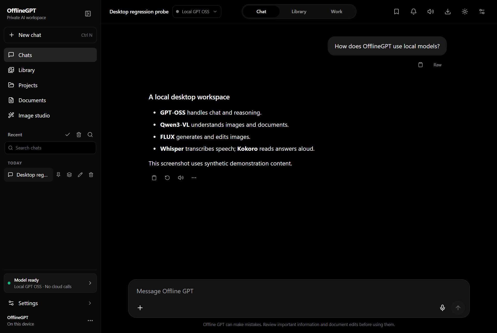
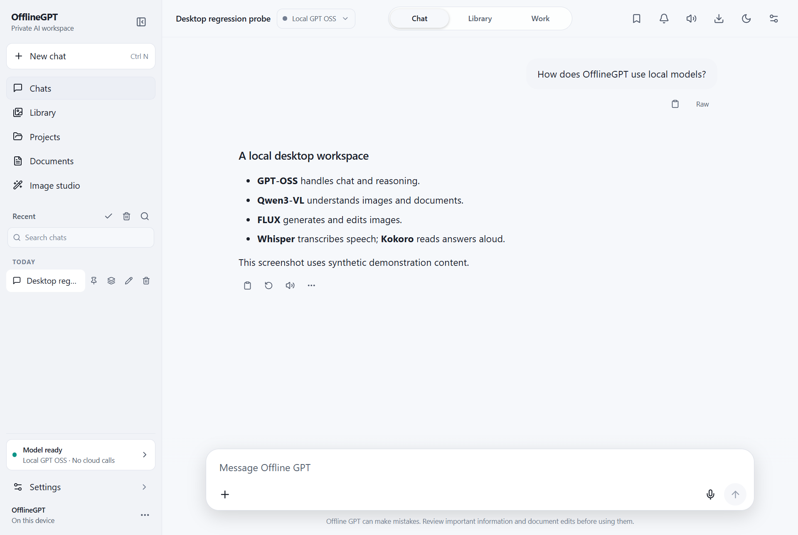
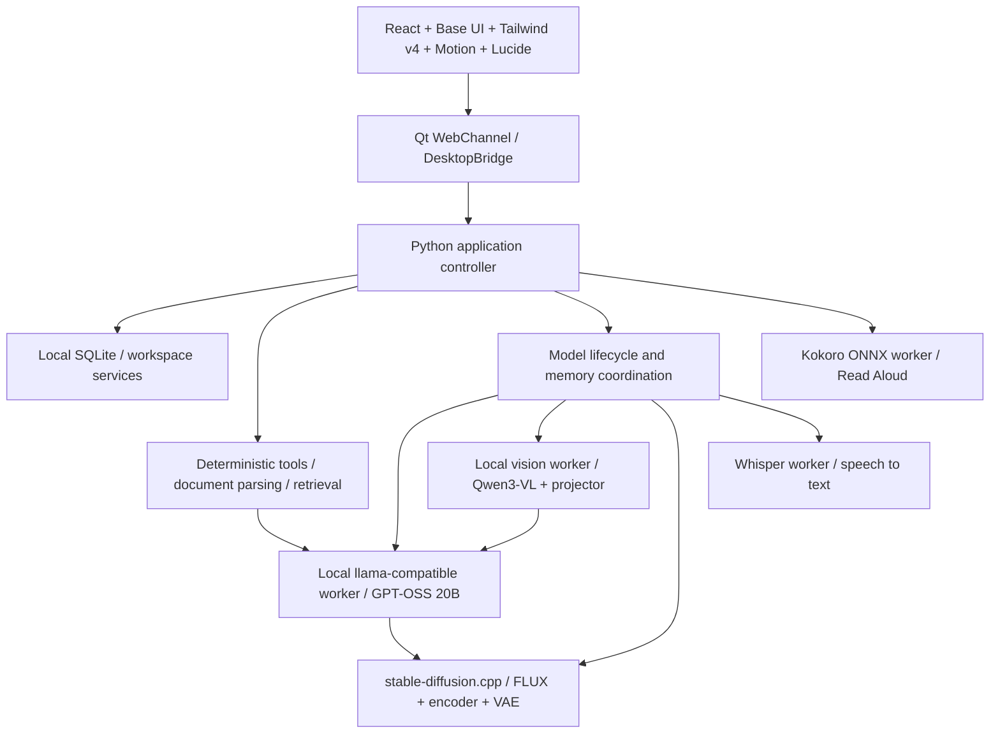

# OfflineGPT

A Windows desktop workspace for local chat, documents, images and voice. Python/PySide6 hosts a bundled React interface in Qt WebEngine. The default inference path is local; no cloud API account is required after dependencies, native runtimes and model assets have been provisioned.

**Development status:** active engineering project with known correctness, performance and hardware acceptance gaps. This repository is a source export, not an installer or a production-readiness claim. It intentionally contains no conversations, databases, model weights, private diagnostics or native engine binaries.

## Implemented capabilities

- **Chat:** GPT-OSS 20B integration, streaming Markdown, code copying, cancellation, retry/regenerate, message versions, conversation search, pin/rename/export, bookmarks and prompt drafts.
- **Controller:** task/subtask IDs, deterministic calculation and exact search tools, output validation, restricted code syntax/structural analysis and runtime-derived task accounting. Validators cover defined criteria; they do not guarantee arbitrary engineering answers are correct.
- **Vision:** Qwen3-VL-8B-Instruct with a matching vision projector for image understanding and OCR. GPT-OSS reasons over the resulting text rather than pretending to see raw pixels.
- **Images:** GPT-OSS prompt planning and direct stable-diffusion.cpp FLUX generation/editing; Original Prompt, Smart Enhance and Creative Direction constraint handling; image variants and non-destructive output. Requested UHD export can involve upscaling/resizing rather than native UHD sampling.
- **Fast image tools:** crop/resize and mask-reviewed deterministic recoloring. Automatic semantic object segmentation is not solved; uncertain masks require review and correction or the generative edit path.
- **Library:** searchable/filterable images, metadata, versions, logical removal/restoration, bulk operations and journal-backed recovery/review for ambiguous file operations. Windows Recycle Bin operations and application-level hidden items have distinct states; absence alone does not certify deletion.
- **Voice:** microphone capture and local Whisper transcription; separate Kokoro-82M ONNX Read Aloud with voice selection, preview and interruption. Accuracy and latency depend on audio input and configuration.
- **Documents:** selectable-text PDF parsing, exact phrase search with physical page locations, local retrieval for explanations, multiple-document workspaces and clickable local citations. PDF/DOCX/PPTX creation and supported document edits save separate outputs. Scanned-document OCR requires vision assets.
- **Historical memory:** local SQLite conversation retrieval with original-record provenance and conservative coverage reporting. External chat histories require explicit import. Complete historical synthesis remains under development.
- **Desktop:** deep-black/light themes, responsive sidebar, attachment controls, per-request timing, reported token statistics, model/resource status, local diagnostics and recovery controls.

The code retains optional LM Studio compatibility. The bundled default starts app-owned loopback inference workers; these are local subprocesses, not a mandatory external desktop app. Image generation invokes the existing local image engine directly; there is no ComfyUI requirement.

## Desktop screenshots

The reviewed screenshots below use **synthetic demonstration content and a mock Qt bridge**, not private conversations or real inference results. They show the actual rebuilt React interface inside Qt WebEngine; they do not prove model performance.

## Architecture

See [architecture and privacy](docs/ARCHITECTURE.md) for boundaries and current limitations.

## Hardware and prerequisites

- Windows x64; Python 3.12 is the observed build interpreter. Other platforms/interpreters are not accepted targets in this export.
- Node.js and pnpm for the frontend. The committed pnpm lockfile supplies exact frontend dependency resolutions.
- An NVIDIA CUDA-compatible runtime/driver for the currently configured native inference engines. Use matching DLL sets, not unrelated DLLs from another application.
- Development/test checks can run without models. Real inference requires separately obtained engines and weights.
- The engineering target is a machine with **16 GB RAM and an RTX 4060 Laptop GPU with 8 GB VRAM**. This is a constrained target, not a guarantee that every workflow fits. Quantized models, bounded context, sequential model loading, adequate free RAM/pagefile and thermal headroom are necessary. Do not keep all GPU models resident together.
- Model assets consume tens of gigabytes, separately from this small source repository. Reserve additional space for environments, native packages, generated assets and rollback copies.

## Setup and build

Follow [SETUP.md](docs/SETUP.md) in a separate checkout. It covers environment setup, frontend compilation, synthetic tests, launching with isolated data and building the Qt shell. The existing private installation is not used or overwritten by these instructions.

**Fresh-checkout boundary:** the frontend and Python shell/test code are present. A complete AI-enabled redistributable still needs native runtime provisioning, compatible model assets and license review. Exact upstream provenance/build flags for the currently used native binaries are not established by this export; a generic latest upstream binary is not guaranteed to accept this controller's flags/protocol.

## Development status and limitations

- The October 15 checkpoint recorded 586 source tests and 17 packaged deterministic smoke checks. Those counts include private acceptance fixtures not shipped here; they are historical evidence, not this checkout's test count.
- Independent model review still found a savepoint/transaction reasoning failure and incomplete historical synthesis. A narrow validator passing is not general correctness acceptance.
- Live laptop-microphone accuracy remains unresolved. Recorded/synthetic checks do not settle physical input behavior.
- UHD thermal acceptance, prolonged mixed-model workloads, true power-loss recovery and automatic semantic masking are not established. Earlier UHD work reached a thermal stop; do not use ordinary unit tests to imply it passed.
- PDF layout-preserving edits are limited; complex layouts/fonts, ambiguous targets, protected documents and scanned text may need manual review. Spreadsheet formula recalculation and full office-editor fidelity are not guaranteed.
- Arbitrary model-generated Python/shell execution is disabled. The available static validation and restricted deterministic operations are not a general sandbox.
- Some logs/output paths still depend on the application directory even when a separate data profile is set. Keep the checkout writable and private local outputs ignored.

Current export verification is documented in [EXPORT_VERIFICATION.md](docs/EXPORT_VERIFICATION.md).

## Dependencies, models and licensing

See [THIRD_PARTY.md](docs/THIRD_PARTY.md) and [MODEL_ASSETS.md](docs/MODEL_ASSETS.md). Major review items include PyMuPDF's AGPL/commercial options, Qt/Chromium obligations, GPL speech dependencies and the FLUX.2 Klein **Base 9B non-commercial** model license. Do not assume every component is MIT/Apache or that private hosting removes redistribution obligations.

No project-wide open-source license is selected by this preparation. Confirm ownership of the application code/branding and choose a compatible licensing policy before broader distribution. Third-party rights remain with their owners. Model files and native runtime binaries are excluded even from the proposed private source upload.

## Publishing privately

### Existing private repository workflow

For approved changes from the separate development workspace, use [SOURCE_SYNC.md](docs/SOURCE_SYNC.md). Synchronization previews an exact allowlist, protects sanitized files, requires a reviewed snapshot, journals recoverable copies and leaves Git staging/commit/push manual. [Presentation roadmap](docs/GITHUB_PRESENTATION_ROADMAP.md) and [Windows distribution plan](docs/WINDOWS_DISTRIBUTION.md) define future work and release gates.

The source manifest now uses portable **v2** hashes: UTF-8 text is normalized to LF and binary assets retain exact-byte hashes. Git history and publication settings are not changed by the synchronizer.

Read [GITHUB_DESKTOP.md](docs/GITHUB_DESKTOP.md). Review the staging contents first; keep **Keep this code private** checked. This preparation creates no remote repository and performs no push.
